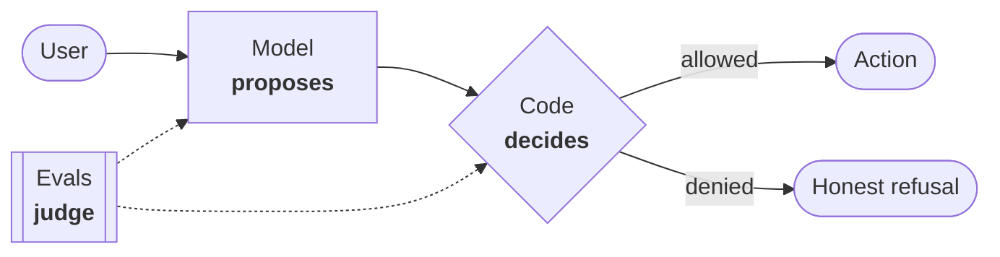

<div align="center">

# The Model Proposes

### Code decides. Evals judge.

Field notes and measured experiments on building **reliable** LLM systems.

[](LICENSE)


[The idea](#the-idea) · [Principles](#principles) · [What's inside](#whats-inside) · [Log](#log) · [Experiment format](#experiment-format)

</div>

---

## The idea

An LLM is a brilliant, unreliable collaborator. Most production failures come from
asking it to *guarantee* things: permissions, arithmetic, confirmations, identifiers.

This repo takes those guarantees away from the model and gives them to code. The model
only proposes; code checks every proposal before anything happens, and evals measure
whether the whole thing works. One small experiment at a time.



> **The model** extracts, classifies and writes.<br/>
> **Code** authorizes, verifies and composes.<br/>
> **Evals** tell you whether any of it is true.

## Principles

| Principle | What it means |
|---|---|
| **Measure, don't vibe** | Every claim comes with a number, an interval and its cost. |
| **Break it first** | Each entry starts with the test that reproduces the failure. |
| **Code-level** | One small module with tests. No platforms, no scaffolding. |
| **Negative results count** | What did not work is published with the evidence. |
| **Reproducible** | One command, pinned versions, public or synthetic data. |

## What's inside

Two kinds of entries, added as the work happens.

| | Kind | What it is |
|---|---|---|
| 🔨 | **Exercises** | Hands-on builds of one technique: code, tests and a short note. |
| 🔬 | **Experiments** | A question, a hypothesis and a measured answer. |

<details>
<summary><b>Areas covered</b></summary>

<br/>

| Area | Topics |
|---|---|
| **LLM fundamentals** | Sampling, structured output, caching, cost |
| **Context engineering** | Budgets, compaction, pre-LLM gates, query rewriting |
| **Harness** | Tool loops, dynamic tool loading, LangGraph, human-in-the-loop, multi-agent |
| **State and memory** | Short and long-term memory, concurrency, state rebuilt from history |
| **Design patterns** | Model extracts / code decides, cascades, propose-confirm-apply, fail-open |
| **Vector search** | Qdrant, hybrid search, reranking, chunking, retrieval metrics |
| **RAG** | Citations, honest no-answer, agentic retrieval |
| **MCP** | Servers, guardrails, auth |
| **Voice and vision** | STT, TTS, voice agents, image-to-query, visual documents |
| **Security** | Prompt injection, authorization in code, red teaming |
| **Evals and observability** | Judges, confidence intervals, tracing, latency |
| **AI product** | Attachments, tabular analysis, generated files |
| **Models and core ML** | Local models, LoRA, classic baselines |

</details>

## Log

Newest first. One line per finished exercise, experiment or paper note.

| Date | Kind | Entry | Takeaway |
|---|---|---|---|
| 2026-11-17 | — | Repository created | Experiment template in place |

## Experiment format

Every experiment is a folder with the same shape, so results stay comparable.

| Section | Content |
|---|---|
| **Question** | One line. |
| **Hypothesis** | Written *before* running anything. |
| **Setup** | Data, models, versions, seed and number of runs. |
| **Result** | A table or chart, with an interval. |
| **Limits** | What it does not show. |
| **Reproduce** | One command. |

Start from [`templates/experiment.md`](templates/experiment.md).

## Layout

```text
the-model-proposes/
├── exercises/<area>/<entry>/      # hands-on builds
├── experiments/<area>/<entry>/    # measured experiments
└── templates/experiment.md        # write-up template
```

## Stack


---

<div align="center">

Built by [Gabriel Rodríguez Ubiera](https://github.com/gabrielroubiera) · [MIT](LICENSE)

</div>
