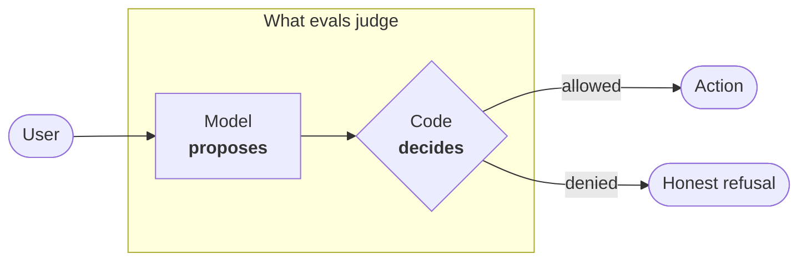

<div align="center">

# The Model Proposes

### Code decides. Evals judge.

A public notebook on AI engineering:<br/>
hands-on builds, measured experiments and paper notes on making LLM systems **reliable**.

[](LICENSE)


[Why](#why-this-exists) · [The thread](#the-thread) · [What's inside](#whats-inside) · [Phases](#phases) · [Areas](#areas) · [Log](#log) · [Format](#experiment-format)

</div>

---

## Why this exists

I build LLM systems for a living, and I want to understand every layer of them well
enough to explain it, break it and measure it. This repo is where that study happens
in the open, with no end date:

- **Build** each technique by hand, from the basics up, until it holds under tests.
- **Measure** the questions that practice raises, instead of trusting intuition.
- **Read** the research, replicate what matters and note where it does not hold.

The long-term goal is to turn the strongest results into publishable work.

## The thread

The repo covers the whole stack, but one conviction runs through it: an LLM is a
brilliant, unreliable collaborator, and most production failures come from asking it
to *guarantee* things such as permissions, arithmetic, confirmations and identifiers.

So the guarantees go to code. The model proposes; code checks every proposal before
anything happens; evals tell you whether the system actually works.



> **The model** extracts, classifies and writes.<br/>
> **Code** authorizes, verifies and composes.<br/>
> **Evals** tell you whether any of it is true.

Not every entry is about this split. Retrieval, voice or fine-tuning entries are here
because you cannot decide where the model should stop without knowing what it can do.

## What's inside

Three kinds of entries, each held to its own bar.

| | Kind | What it is | The bar |
|---|---|---|---|
| 🔨 | **Exercise** | One technique built by hand | Working code, offline tests where there is logic that can break, a short note on what was learned |
| 🔬 | **Experiment** | A question with a measured answer | Hypothesis written first, repeated runs, an interval, the cost, the limits |
| 📄 | **Paper note** | A paper read or replicated | What it claims, how it measures it, what it does not show |

Rules that apply to all of them:

| Rule | What it means |
|---|---|
| **Code-level** | Small modules, not platforms. Nothing is scaffolded in advance. |
| **Reproducible** | One command, pinned versions, a fixed seed where it applies. |
| **Open data only** | Public or synthetic data. Nothing from an employer or a client. |
| **Negative results count** | What did not work is published with the evidence. |
| **Failures first** | When an entry is about a failure mode, it starts with the test that reproduces it. |

## Phases

The work runs in two phases, in order.

| Phase | What it is | Status |
|---|---|---|
| **1 · Build** | The fundamentals: each technique built by hand, to have a base to measure from | In progress |
| **2 · Measure** | Experiments in the [experiment format](#experiment-format), starting when phase 1 ends | Not started |

Phase 1 exercises end with open questions they cannot answer with a few runs. They are
collected in [`experiments/BACKLOG.md`](experiments/BACKLOG.md) as input for phase 2.

## Areas

<details open>
<summary><b>Phase 1 · Build</b> — exercises</summary>

<br/>

| Area | Topics |
|---|---|
| **LLM fundamentals** | Sampling, structured output, caching, cost |
| **Context engineering** | Budgets, compaction, pre-LLM gates, query rewriting |
| **Harness** | Tool loops, dynamic tool loading, LangGraph, human-in-the-loop, multi-agent |
| **State and memory** | Short and long-term memory, concurrency, state rebuilt from history |
| **Design patterns** | Model extracts / code decides, cascades, propose-confirm-apply, fail-open |
| **Vector search** | Qdrant, hybrid search, reranking, chunking, retrieval metrics |
| **RAG** | Citations, honest no-answer, agentic retrieval |
| **MCP** | Servers, guardrails, auth |
| **Voice and vision** | STT, TTS, voice agents, image-to-query, visual documents |
| **Security** | Prompt injection, authorization in code, red teaming |
| **Evals and observability** | Judges, confidence intervals, tracing, latency |
| **AI product** | Attachments, tabular analysis, generated files |
| **Models and core ML** | Local models, LoRA, classic baselines |
| **Serving** | OpenAI-compatible endpoints, streaming, cancellation, degradation |

</details>

<details>
<summary><b>Phase 2 · Measure</b> — experiments</summary>

<br/>

| Area | Questions |
|---|---|
| **Experimental method** | Variance, ablations, significance with few cases, cost reporting |
| **Agent reliability** | Tool and agent count, consistency, prompt versus code, long-context decay |
| **Calibration and uncertainty** | Confidence, abstention, self-consistency, judge reliability |
| **Retrieval in depth** | Synthetic eval sets, cross-lingual search, numbers and tables, thresholds |
| **Output control** | Constrained decoding, schema failure rates, prompt optimization |
| **Economics** | Cost-quality frontier, distillation, semantic caching |
| **Data** | Datasets from traces, synthetic cases, drift |
| **Measured security** | Attack success rate, injection channels, the cost of each defense |
| **Voice in Spanish** | Transcription accuracy on regional Spanish, turn-taking, perceived latency |

</details>

## Log

Newest first. One line per finished exercise, experiment or paper note.

| Date | Kind | Entry | Takeaway |
|---|---|---|---|
| 2026-11-24 | Exercise | [07 · Window budget](exercises/context-engineering/07-window-budget/) | Tool results are capped one by one and per turn, with each cut note counted inside its cap, and a base prompt that does not fit raises before any call. The chars/4 estimate fell short of the provider's count by about 60% on a synthetic prompt, in two calls, so the caps are only as good as the counter |
| 2026-11-19 | Exercise | [06 · Prompt rewrite](exercises/context-engineering/06-prompt-rewrite/) | On three tickets, a vague prompt let the model pick a different role and shape per ticket in two runs. Role, `<ticket>` delimiters, a two-line format and two examples gave the same parseable shape on all three, in one run. Both prompts refused the injected instruction, so this does not show what delimiters stop |
| 2026-11-19 | Exercise | [05 · Prompt caching](exercises/llm-fundamentals/05-prompt-caching/) | In four runs of three to six calls, cache hits cost 3–5 times less. Hits came only while consecutive calls stayed on one provider, and a pinned provider still missed once. No latency gain detected at about 3000 tokens |
| 2026-11-19 | Exercise | [04 · Parameter layer](exercises/llm-fundamentals/04-parameter-layer/) | One function drops `temperature` when reasoning effort is set, and says so. In one run per setting, the model reasoned with no effort set, and `high` used fewer reasoning tokens than `low` (36 against 54). Effort did not act as a budget there |
| 2026-11-19 | Exercise | [03 · Structured output](exercises/llm-fundamentals/03-structured-output/) | On one clear ticket, JSON mode, tool calling and a strict schema returned a valid object in every run. Valid is not correct: `product` differed between ways. A tested validator with a capped retry decides what is accepted |
| 2026-11-17 | Exercise | [02 · Sampling](exercises/llm-fundamentals/02-sampling/) | Temperature 0 gave 3 distinct answers of 5 with the provider fixed. No `top_p` effect detected with n=5. DeepSeek's docs say its own API ignores `temperature` while thinking and raises `top_p` below 0.95 to 0.95, so the settings may not have been applied |
| 2026-11-17 | Exercise | [01 · Raw API call](exercises/llm-fundamentals/01-raw-api-call/) | A chat call is one POST with a list of messages. Streaming is the same request with `stream: true`, and `usage` comes in the last chunk. In one call, reasoning took 128 of 158 completion tokens |
| 2026-11-17 | — | Repository created | Experiment template in place |

## Experiment format

Every experiment is a folder with the same shape, so results stay comparable.

| Section | Content |
|---|---|
| **Question** | One line. |
| **Hypothesis** | Written *before* running anything. |
| **Setup** | Data, models, versions, seed and number of runs. |
| **Result** | A table or chart, with an interval. |
| **Limits** | What it does not show. |
| **Reproduce** | One command. |

Start from [`templates/experiment.md`](templates/experiment.md).

## Layout

Folders appear as the work happens.

```text
the-model-proposes/
├── exercises/<area>/<entry>/      # hands-on builds
├── experiments/<area>/<entry>/    # measured experiments
├── papers/<paper>.md              # reading and replication notes
└── templates/experiment.md        # write-up template
```

## Stack


---

<div align="center">

Built by [Gabriel Rodríguez Ubiera](https://github.com/gabrielroubiera) · [MIT](LICENSE)

</div>
