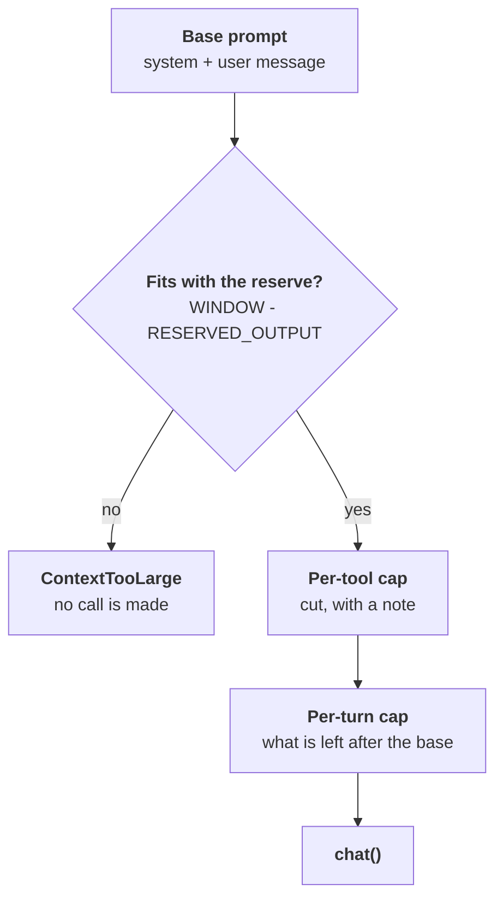

# 07 · Window budget

Tool results are capped one by one and per turn, and a base prompt that does not fit
raises an error before the model is called.

## Why

- **The context window is finite.** One tool that returns a whole table can take the space the rest of the prompt and the answer need.
- **Code should split the space, not the provider.** Too much context sent to a provider fails or gets truncated somewhere you do not control, after the call is paid for. Checking first makes the failure cheap and clear.
- **The model should know what it did not see.** A cut result carries a note, so the model can say information is missing instead of answering as if it had everything.

Later exercises on compaction and long histories spend this same budget.

## The code, block by block

The code is in [`budget.py`](budget.py).

**`sys.path.append(...)` and the import.** Reuses `chat` and `LLM_MODEL` from exercise 01, going up three levels as in exercise 06.

**The constants.** `WINDOW` is 8000 tokens, small on purpose so the limits are easy to hit. `RESERVED_OUTPUT` keeps 1000 of them free for the answer. `TOOL_CAP` caps one tool result at 1500 and `TURN_CAP` caps all results in a turn at 3000. `OMIT_RESERVE` keeps 20 tokens for the note that says results were left out. `CHARS_PER_TOKEN` is 4, a rough rule and not a tokenizer.

**`ContextTooLarge`.** An error of its own, so the caller can tell "the prompt does not fit" apart from a network or provider error.

**`estimate_tokes(text)`.** Characters divided by `CHARS_PER_TOKEN`, rounded up. It avoids adding a tokenizer dependency. Every cap in the file is only as accurate as this count, and the output section shows it fell short.

**`cap_tool_result(text, cap)`.** Returns the text unchanged if it fits. If not, it builds the `[truncated: ...]` note first and keeps `cap` minus the note's size, so the result with its note stays within `cap`. The first version cut to `cap` and then added the note, which gave 1510 for a cap of 1500.

**`fit_turn(results, turn_cap)`.** Passes each result through its own cap, then checks what is left of the turn. If more than 50 tokens are left, the result is cut to fit. If not, the loop stops and one note says how many results were omitted. That note's space, `OMIT_RESERVE`, is taken off the budget at the start. The first version added a note for each omitted result with no space kept for it, and the turn came to 3008 of 3000.

**`build_turn(system, user, results)`.** Estimates the base prompt. If the base plus `RESERVED_OUTPUT` does not fit in `WINDOW`, it raises `ContextTooLarge` and nothing is sent. Otherwise the turn cap becomes `min(TURN_CAP, room)`, so a long system prompt leaves less space for tools. It returns the user message with the fitted results appended.

**The `__main__` block.** Four synthetic results of about 1200, 3750, 800 and 400 tokens, and three system prompts: a short one, a long one of about 6000 tokens and one of about 12000. Only the short one calls the model, and it prints `usage.prompt_tokens` next to the estimate.

## What to look at in the output

| Field | Meaning |
|---|---|
| `estimated prompt` | The estimate of system plus user, against `WINDOW - RESERVED_OUTPUT` |
| `usage.prompt_tokens` | What the provider counted for the same prompt |
| `no call made` | The base did not fit, so `chat()` was never called |
| `answer` | Whether the model read the omission note |

Seen while building it:

- **Each cap held once its note was counted inside it.** With the results above and the default caps, they came to 1200, 1500, 280 and an omission note, 2990 of 3000 in total.
- **A total under the cap does not prove the budget is right.** With an inverted condition, a result that had room was omitted and the total still came to 2710, under the cap.
- **The estimate fell short by about 60%.** For the short system prompt it gave 3010 tokens and the provider counted 4820 and 4819 in two calls. The text is a repeated synthetic pattern, so this does not say what the ratio is for normal text. With a tighter window, a prompt the code accepted would not have fit.
- **The tool budget followed the base.** With the long system prompt the turn got only what was left and the estimate came to 6991 of 7000.
- **A base of 12009 tokens raised before any call.**
- **The model read the omission note.** Asked how many results were omitted, it answered "1 tool result was omitted." and, in the second run, "1". No format was asked for, so the shape changed between runs.

## Open questions

Measurable questions this exercise raises but cannot answer with a few runs. They are
collected for phase 2 in [`experiments/BACKLOG.md`](../../../experiments/BACKLOG.md).

- How far is a characters-per-token estimate from `usage.prompt_tokens` on normal English and Spanish text? Here it fell short by about 60% on a synthetic pattern.
- Does the model use the truncation and omission notes when it answers, over many prompts? It reported the omission correctly in two runs.
- What does a provider do when the prompt really goes past its window: an error, a silent cut or something else?
