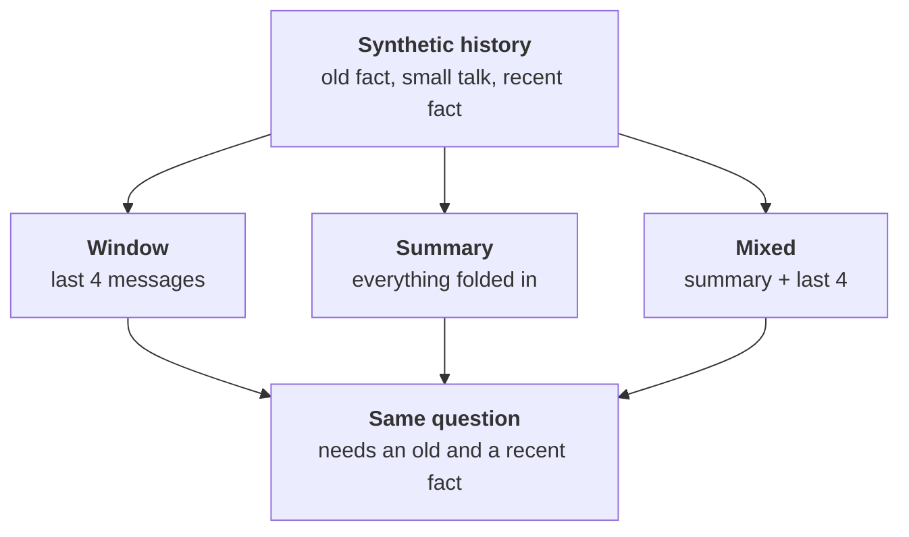

# 08 · History compaction

One support conversation shrunk three ways: a sliding window, an incremental summary and
a mix of both. The same question then shows what each one forgot.

## Why

- **History grows every turn.** Exercise 07 capped tool results. In a long conversation, the messages themselves fill the window.
- **Each way of shrinking it loses something different.** A window keeps recent messages exactly and drops everything older. A summary keeps old facts, but only roughly, and it costs a model call. A mix keeps recent messages exactly and summarizes the rest.
- **Holding a fact is not the same as using it.** A summary can contain a fact the model then ignores, so the comparison is made on answers, not on summaries.

Later exercises on memory and long-running agents choose between these same trade-offs.

## The code, block by block

The code is in [`compaction.py`](compaction.py).

**`sys.path.append(...)` and the import.** Reuses `chat` and `LLM_MODEL` from exercise 01, going up three levels as in exercise 07.

**`KEEP_LAST`.** How many messages are kept word for word: 4.

**`HISTORY`.** Ten synthetic messages. The order number `A-7731` and the cracked blender lid come first, the office address `Calle Duarte 45, second floor` comes last. The question needs both, so a strategy that keeps only one end fails.

**`SUMMARY_SYSTEM`.** Tells the model to update a running summary and to keep identifiers, names, numbers and addresses exactly as written. A production prompt would ask for the same thing, but it also tells the model which facts to protect, so the results here do not say what a summary keeps without that instruction.

**`AGENT_SYSTEM` and `QUESTION`.** The agent answers only from the context and says when it does not know. Without that permission, a model missing the order number might invent one. The question asks for the order, the damaged part and the address.

**`ask(context)`.** Sends the context and the question to the model and returns the answer.

**`render(messages)`.** Turns messages into `role: content` lines. `chat()` takes one user message, so the history travels as text inside it.

**`sliding_window(history, keep)`.** Returns the last `keep` messages. No call, no cost, and anything older is gone.

**`update_summary(summary, messages)`.** Sends the current summary and the new messages, and returns the updated summary. It never sees the full history again, which keeps each call small and means a fact lost in one summary stays lost in every later one.

**`compact(history, keep)`.** Splits the history into old and recent messages and folds the old ones into the summary two at a time. `keep=0` gives the summary-only strategy, five calls for ten messages. `keep=4` gives the mixed one, three calls for the six old messages.

**The `__main__` block.** Builds the three contexts, prints their length in characters and asks the question with each. Characters are not tokens (see exercise 07), but they are enough to compare the three strategies with each other.

## What to look at in the output

| Field | Meaning |
|---|---|
| `context is N chars` | How much of the window each strategy uses |
| `answer` | Whether it names `A-7731`, the lid and the address, or says it does not know |

Seen while building it, one run each:

- **The window lost the old facts and said so.** It kept 4 of 10 messages, 207 of 490 characters. The answer gave the address and said it did not know the order or the damaged part. It did not invent them.
- **Both summaries held all three facts.** Printed on their own, they kept `A-7731`, the cracked lid and `Calle Duarte 45, second floor` word for word, and with them both strategies answered all three parts of the question.
- **The summary-only version dropped how decisions were made.** It no longer said the customer chose a replacement over a refund, or that the office address replaced the home one. It kept only the outcome. The question did not need either, so the answer did not show it.
- **The mixed summary spent words on filler.** It quoted the assistant's "Done. Anything else I can help with?" word for word.
- **On a history this short, compaction barely saved space.** The full history is 490 characters. The summary context was 402, after five calls, and the mixed one was 463, after three. Summaries pay off only when the history is much longer than the summary.
- **The summaries were not printed in the question run.** The `__main__` block rebuilds them on each run, so the summaries behind the answers are not the ones quoted above.

## Open questions

Measurable questions this exercise raises but cannot answer with a few runs. They are
collected for phase 2 in [`experiments/BACKLOG.md`](../../../experiments/BACKLOG.md).

- How often does an incremental summary lose or change an identifier over long conversations and many runs? It kept `A-7731` in both runs here, with an instruction to keep it.
- Does the instruction to keep identifiers exact change how often they survive?
- At what history length does a summary start to save more space than it costs in calls?
- How often does a model with a window-only context invent a fact it no longer has, instead of saying it does not know?
