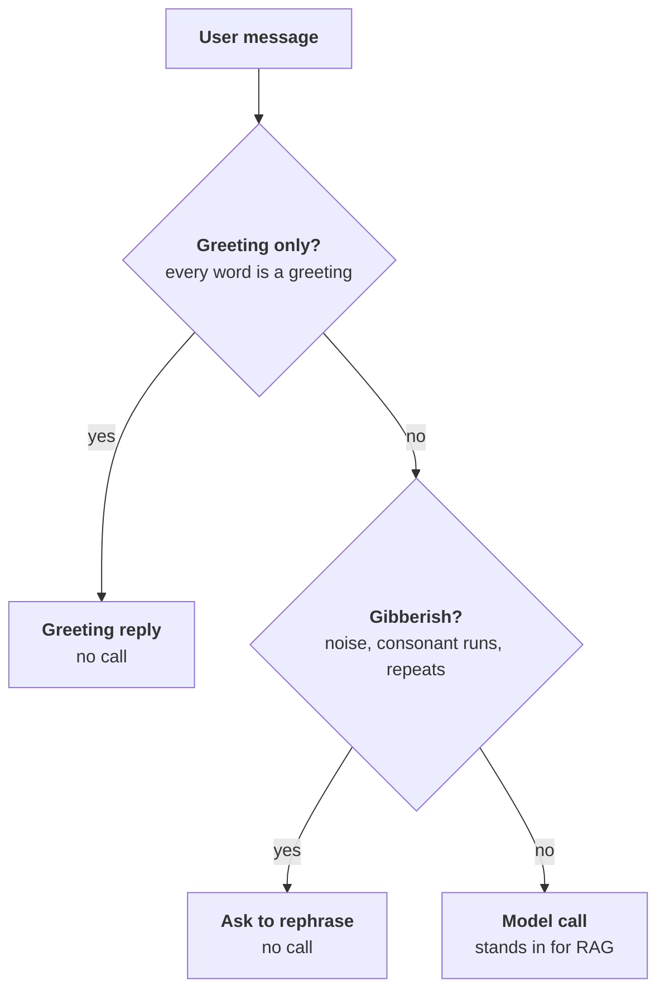

# 09 · Pre-LLM gates

Two checks in plain code, a greeting detector and a gibberish detector, answer some
messages with a fixed reply so they never reach retrieval or the model.

## Why

- **Some messages have nothing to retrieve.** A bare "hola" sent through RAG pulls random chunks, and the model may answer with something off topic. It also costs an embedding and a call.
- **Code is cheaper and more predictable here.** Both checks are a few rules that give the same answer every time and can be tested without a model.
- **Each gate can be wrong in two directions, and the costs differ.** A greeting that slips through costs one extra call. A real question treated as a greeting or as gibberish is lost. So both gates are strict and let doubtful messages through.

Later exercises with real retrieval put these gates in front of it.

## The code, block by block

The code is in [`gates.py`](gates.py).

**The imports and `sys.path.append(...)`.** `re` and `unicodedata` do the work of the gates. `chat` and `LLM_MODEL` come from exercise 01, going up three levels as in exercise 08, and are used only on the path that reaches the model.

**`GREETINGS`.** The greeting words in English and Spanish, written without accents because messages are normalized before the lookup. Anything not in the set is not a greeting, so the set decides how strict the gate is.

**`CONSONANT_RUN` and `REPEAT`.** Two patterns for words that look like keyboard noise: five or more consonants in a row (`asdkjh`) and one character repeated four or more times (`aaaaaaa`).

**`GREETING_REPLY`, `REPHRASE_REPLY` and `SYSTEM`.** The two fixed replies, and the system prompt for the model call.

**`normalize(text)`.** Lowercases, removes accents and splits into words of letters and digits. Without it, "Buenos días!" would not match `buenos` and `dias`, and punctuation would count as part of a word.

**`is_greeting(text)`.** True only when there is at least one word and every word is in `GREETINGS`. The rule is "only greetings", not "contains a greeting", so "Hola, mi pedido A-7731 llegó roto" goes on to the model. An empty message is not a greeting.

**`is_gibberish(text)`.** An empty message is gibberish. So is one where less than half of the non-space characters are letters or digits (`!!!???`). Otherwise it counts the words that match `CONSONANT_RUN` or `REPEAT`, and the message is gibberish when more than half do. The noise check runs first, so a message with no words returns before the division by `len(words)`.

**`route(text)`.** Runs the greeting gate first, then the gibberish gate, and returns the gate's name with its fixed reply, or `"rag", None` when the message should go on. The order matters: the gibberish gate does not know greetings, so checking it first could treat a greeting as noise.

**The `__main__` block.** Routes eight messages. When `route` returns no reply, it calls the model with the message directly, because the repo has no retrieval yet. It prints each gate and reply, and the number of model calls.

## What to look at in the output

| Field | Meaning |
|---|---|
| `[greeting]`, `[gibberish]`, `[rag]` | Which gate decided |
| `->` | The fixed reply, or the model's answer on the `rag` path |
| `model calls: N of M` | How many messages reached the model |

Seen while building it, one run:

- **Two of eight messages reached the model.** The two greetings, the noise, the empty message and two false positives were answered without a call.
- **`"holaaaa"` was treated as gibberish.** It is not in `GREETINGS`, so it passed the greeting gate, and `REPEAT` caught it. A user who greets with a stretched word is asked to rephrase.
- **`"strengths"` was treated as gibberish.** `ngths` is a real run of five consonants. In `"strengths and weaknesses"` only one word of three matched, so that sentence passed. The majority rule protects sentences, not single words.
- **`"hey there"` slipped past the greeting gate.** `there` is not in the set, so it cost a call. The model answered with a greeting of its own, so nothing was lost but the call.
- **The fixed replies are in English and do not follow the user's language.** The model answered the Spanish question in Spanish. It said it had no access to order `A-7731`, which is expected with no retrieval behind it.

## Open questions

Measurable questions this exercise raises but cannot answer with a few examples. They are
collected for phase 2 in [`experiments/BACKLOG.md`](../../../experiments/BACKLOG.md).

- How often do the gates stop a real question, on a set of real-looking support messages in Spanish and English? Two of eight synthetic messages here were false positives.
- What share of real traffic do the gates answer without a call, and what does that save?
- Does a small classifier or a cheap model separate greetings and noise better than these rules, at what cost per message?
