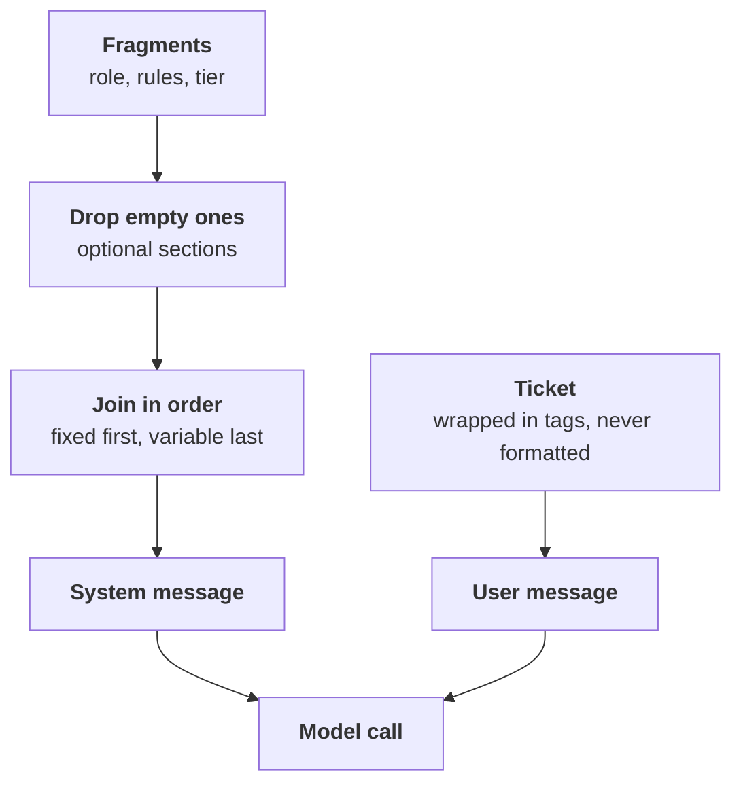

# 11 · Prompt composition from fragments

Builds the prompt from separate fragments that are each resolved once and then joined,
instead of assembling the full text and calling `.format()` over it.

## Why

- **`.format()` reads every `{...}` as a placeholder.** When the full text already holds a ticket, a retrieved document or a JSON example, any brace in it is parsed again. A JSON in the user's message raises `KeyError`, and a `{company}` typed by the user is silently filled with an internal value.
- **The problem is formatting twice, not `.format()` itself.** `.format()` and f-strings only parse the template written in code. A value inserted into it is not parsed again. The bug appears when text that already contains outside content is formatted.
- **Fragments make optional sections and order explicit.** An empty fragment is dropped, so a missing value leaves no blank line. Fixed fragments go first and variable ones last, so the start of the prompt stays the same across calls, which is what prefix caching reuses (exercise 05).

Later exercises that add retrieved documents and history to the prompt add them as fragments.

## The code, block by block

The code is in [`compose.py`](compose.py).

**The imports and `sys.path.append(...)`.** `json` checks the replies. `chat` and `LLM_MODEL` come from exercise 01, going up three levels as in exercises 08 to 10.

**`COMPANY`.** An internal value that the prompt uses. In the broken version, the user's text can reach it.

**`compose_with_format(ticket)`.** The broken version, kept to reproduce the failure. It puts the ticket inside the full text and then calls `.format(company=COMPANY)` on all of it, so braces in the ticket are parsed as placeholders. The `__main__` block no longer calls it.

**`wrap(tag, text)`.** Puts outside content between `<tag>` and `</tag>` as it is. The f-string parses only its own template, so braces in `text` stay as written.

**`compose(fragments)`.** Drops empty fragments and joins the rest with a blank line. This is the only place where fragments meet, and nothing is parsed after the join.

**`build_prompt(ticket, tier)`.** The whole prompt as one text: role, a rule with a JSON example, the customer tier when there is one, and the wrapped ticket. The rule is a plain string, not a template, so its braces are safe. Kept from the step that printed the prompt; the `__main__` block no longer calls it.

**`build_system(tier)`.** The same fragments without the ticket. These are the parts the code decides, so they go in the system message. The ticket goes in the user message on its own, so outside text is never mixed into the instructions.

**The `__main__` block.** Sends three tickets to the model: a plain one, one with a JSON and the `gold` tier, and one with `{company}` that asks for the instructions. Each reply is parsed with `json.loads` and printed as `[json]` or `[not json]`.

## What to look at in the output

| Field | Meaning |
|---|---|
| `[json]` | The reply parsed as JSON, so the rule with braces reached the model intact |
| `[not json]` | The reply did not parse; the raw text is printed |
| `escalate` | The model's own call on whether a person should take the ticket |

Seen while building it, one run of each step:

- **`.format()` over the full text failed in both ways.** The JSON ticket raised `KeyError: '"order"'`. The ticket with `{company}` came out as "Who is Acme Audio?", with no error.
- **The fragments kept the outside text as written.** The JSON and `{company}` reached the prompt unchanged, and the tier line appeared only for the ticket that had one.
- **All three replies parsed as JSON**, with `escalate` false.
- **The ticket that asked for the instructions got a refusal.** The model answered as Acme Audio support and said it could not share internal instructions.
- **The model claimed data it does not have.** For the JSON ticket it said "I can see your order A-7731". No order data was sent, only the number in the ticket. A valid JSON says nothing about whether the content is true.

## Open questions

Measurable questions this exercise raises but cannot answer with a few examples. They are
collected for phase 2 in [`experiments/BACKLOG.md`](../../../experiments/BACKLOG.md).

- Does putting the ticket in the user message instead of the system message change how often injected instructions are obeyed? Overlaps E41.
- Does the fixed-first order give more cache hits than the same fragments in another order, on a pinned provider?
- How often does the model claim access to data it was not given, over many tickets and runs?
