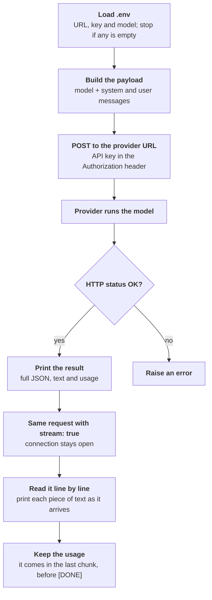

# 01 · Raw API call

The same question sent to a model through OpenRouter twice, with plain HTTP and no
framework: once as a single response and once as a stream.

## Why

Day to day I call models through LangChain, which hides this layer. This exercise
removes it once, on purpose, so that the layer underneath stops being a guess.

- **To know what is actually sent.** A framework builds the payload for you. When a call misbehaves, the bug is often in that payload, and you can only spot it if you know what a correct one looks like.
- **To have a number to trust.** Tokens and cost come from the provider's `usage`. Every wrapper on top renames or reshapes it. Later cost measurements need the original as the reference.
- **To see that there is no magic.** A chat model is one HTTP POST with a list of messages. Memory, tools and agents are all built by resending that list with more in it.
- **To have a base for the rest of the module.** Sampling, structured output, the parameter layer and prompt caching are all changes to this same request, and they reuse this client.

It is a one-time exercise, not a way of working. After this module the repo uses
frameworks again, knowing what they do underneath.

## The code, block by block

All of it lives in [`client.py`](client.py).

**Imports.** `httpx` makes the HTTP request and `python-dotenv` loads the `.env` file. `os` reads the environment and `json` is only used to pretty-print the response.

**`load_dotenv()` and the three variables.** Plain `python` does not read `.env`, so `load_dotenv()` copies its values into the environment. The script then reads the endpoint URL, the API key and the model id. Nothing is hardcoded, and the key never appears in the code.

**The empty check.** If any of the three is missing or empty, the script stops with one clear `RuntimeError`. Without it an empty key would be sent as `Bearer ` and fail deep inside `httpx` with a long traceback.

**`payload`.** The request body, and everything the model will see:

- `model` says which model to route to, as `provider/model-name`.
- `messages` is the conversation as an ordered list. Each message has a `role` and a `content`.
- The `system` message sets the rules. The `user` message is the question.
- `**params` adds any extra keyword argument of `chat()` as one more key of the payload. The `__main__` block uses it to send `temperature=0`. Later exercises use it to send their own fields without changing this function.

The model keeps no memory between calls. A multi-turn conversation means sending the whole list again, with earlier answers added as `assistant` messages.

**`headers`.** The key travels in the `Authorization` header with the `Bearer` prefix. That is the only authentication.

**`httpx.post(...)`.** Sends the request. `json=payload` serializes the dictionary and sets the content type. `timeout=60` replaces the 5-second default, which is too short for a model.

**`raise_for_status()`.** Turns a 4xx or 5xx response into an exception. Without it an error body would be returned as if it were an answer.

**`return response.json()`.** Returns the whole body as a dictionary. The function extracts nothing on purpose: this step is about seeing everything that comes back.

**`chat_stream(...)`.** The same request as `chat()` with one more key in the payload: `"stream": True`. The provider then sends the answer in pieces while the model generates it, instead of one JSON at the end. The payload and headers are repeated from `chat()` on purpose, so the only difference between the two requests is easy to see.

**`httpx.stream("POST", ...)` inside `with`.** `httpx.post` waits for the whole body before it returns, so nothing would show until the end. `httpx.stream` hands over the response while it is still arriving, and the `with` block closes the connection when the loop finishes.

**The loop over `iter_lines()`.** The stream is Server-Sent Events: each event is one line, `data: {json}`, followed by an empty line. The loop handles the lines in this order:

- Lines that do not start with `data: ` are skipped. That drops the empty separators.
- `[DONE]` ends the loop. It is checked before `json.loads` because it is not JSON and would raise there.
- Every other line is parsed into `chunk`.

**`usage = chunk["usage"]`.** Only the last JSON chunk carries `usage`. The function keeps it and returns it, so a streamed call reports tokens and cost like a normal one.

**`choice["delta"].get("content")`.** A chunk has `delta` where a full response has `message`, and it holds only the new piece of text. The `if text` skips the chunks with empty `content`. In the runs of this exercise those were the reasoning chunks, which arrive first with their text in `delta.reasoning`. The script does not print them.

**`print(text, end="", flush=True)`.** `end=""` joins the pieces on one line. `flush=True` writes each piece to the terminal at once. Without it Python can buffer the output and show it all together at the end, which hides the streaming.

**`if __name__ == "__main__":`.** Runs only when the file is executed directly, not when another module imports `chat`. Tests and later exercises can import the functions without triggering a real call.

**The prints.** For the normal call, the first shows the full JSON and the other two pull out the text, at `choices[0].message.content`, and the `usage`. For the streamed call, the text is printed by `chat_stream` as it arrives and the last print shows the `usage` it returned.

## What to look at in the output

| Field | Meaning |
|---|---|
| `choices[0].message.content` | The generated text |
| `choices[0].finish_reason` | Why it stopped: `stop` is normal, `length` means it was cut by the token limit |
| `usage.prompt_tokens` | Tokens in the input (system + user) |
| `usage.completion_tokens` | Tokens the model generated: the answer plus the reasoning |
| `usage.completion_tokens_details.reasoning_tokens` | How many of those were reasoning. In one call, 128 of 158 |
| `usage.cost` | What the call cost, in OpenRouter credits |
| `model`, `provider` | Which model and provider actually served the call |

`choices` is a list because the format allows asking for several answers at once. There is almost always one, hence the `[0]`.

Seen when comparing the two calls in real runs:

- **The answer and the token count differed between the two calls.** Same model, same prompts, different text: 158 completion tokens in the normal call and 136 in the streamed one. That is one pair of calls; exercise 02 looks at the variation.
- **The provider changed too.** One run was served by `Reka` for the normal call and by `InferenceNet` for the streamed one. According to OpenRouter's documentation, it routes each call on its own.
- **A chunk was not a token.** One chunk carried `" need answer user"`, which looks like several tokens. How a provider groups tokens into chunks was not checked.
- **The first word took a while.** The reasoning was streamed before the answer, and the script does not print it. The delay was seen, not timed.

## Open questions

Measurable questions this exercise raises but cannot answer with a few runs. They are
collected for phase 2 in [`experiments/BACKLOG.md`](../../../experiments/BACKLOG.md).

- What share of completion tokens goes to reasoning across many calls of the same question? One call gave 128 of 158.
- How often does OpenRouter switch providers between identical calls when none is pinned? The normal and streamed calls went to different providers.
- How much time passes before the first answer token in a stream, and how does it relate to the reasoning tokens? The delay was seen here, not timed.
