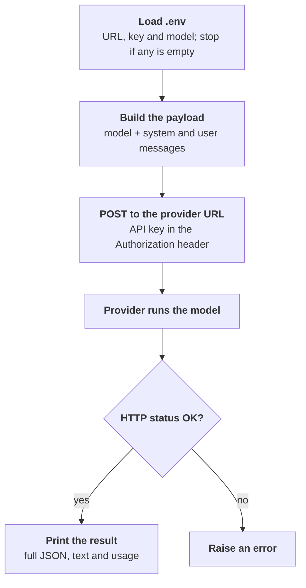

# 01 · Raw API call

One call to a model through OpenRouter, with plain HTTP and no framework.

## Why

Day to day I call models through LangChain, which hides this layer. This exercise
removes it once, on purpose, so that the layer underneath stops being a guess.

- **To know what is actually sent.** A framework builds the payload for you. When a call misbehaves, the bug is often in that payload, and you can only spot it if you know what a correct one looks like.
- **To have a number to trust.** Tokens and cost come from the provider's `usage`. Every wrapper on top renames or reshapes it. Later cost measurements need the original as the reference.
- **To see that there is no magic.** A chat model is one HTTP POST with a list of messages. Memory, tools and agents are all built by resending that list with more in it.
- **To have a base for the rest of the module.** Sampling, structured output, the parameter layer and prompt caching are all changes to this same request, and they reuse this client.

It is a one-time exercise, not a way of working. After this module the repo uses
frameworks again, knowing what they do underneath.

## The code, block by block

All of it lives in [`client.py`](client.py).

**Imports.** `httpx` makes the HTTP request and `python-dotenv` loads the `.env` file. `os` reads the environment and `json` is only used to pretty-print the response.

**`load_dotenv()` and the three variables.** Plain `python` does not read `.env`, so `load_dotenv()` copies its values into the environment. The script then reads the endpoint URL, the API key and the model id. Nothing is hardcoded, and the key never appears in the code.

**The empty check.** If any of the three is missing or empty, the script stops with one clear `RuntimeError`. Without it an empty key would be sent as `Bearer ` and fail deep inside `httpx` with a long traceback.

**`payload`.** The request body, and everything the model will see:

- `model` says which model to route to, as `provider/model-name`.
- `messages` is the conversation as an ordered list. Each message has a `role` and a `content`.
- The `system` message sets the rules. The `user` message is the question.

The model keeps no memory between calls. A multi-turn conversation means sending the whole list again, with earlier answers added as `assistant` messages.

**`headers`.** The key travels in the `Authorization` header with the `Bearer` prefix. That is the only authentication.

**`httpx.post(...)`.** Sends the request. `json=payload` serializes the dictionary and sets the content type. `timeout=60` replaces the 5-second default, which is too short for a model.

**`raise_for_status()`.** Turns a 4xx or 5xx response into an exception. Without it an error body would be returned as if it were an answer.

**`return response.json()`.** Returns the whole body as a dictionary. The function extracts nothing on purpose: this step is about seeing everything that comes back.

**`if __name__ == "__main__":`.** Runs only when the file is executed directly, not when another module imports `chat`. Tests and later exercises can import the function without triggering a real call.

**The three prints.** The first shows the full JSON. The other two pull out the text, at `choices[0].message.content`, and the `usage`.

## What to look at in the output

| Field | Meaning |
|---|---|
| `choices[0].message.content` | The generated text |
| `choices[0].finish_reason` | Why it stopped: `stop` is normal, `length` means it was cut by the token limit |
| `usage.prompt_tokens` | Tokens in the input (system + user) |
| `usage.completion_tokens` | Tokens in the answer |
| `usage.cost` | What the call cost, in OpenRouter credits |
| `model`, `provider` | Which model and provider actually served the call |

`choices` is a list because the format allows asking for several answers at once. There is almost always one, hence the `[0]`.
