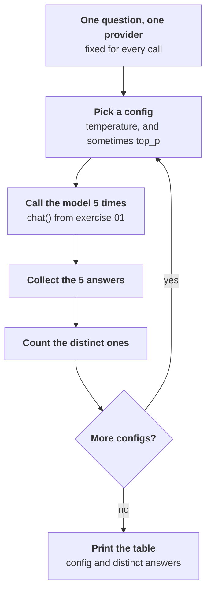

# 02 · Sampling

The same question asked five times under five settings of `temperature` and `top_p`,
counting how many different answers come back.

## Why

A model does not return the answer. It returns one draw from many possible answers,
and `temperature` and `top_p` shape that draw.

- **To see the variation instead of assuming it.** "Lower temperature is more stable" is something everyone repeats. This puts a count next to it.
- **To learn what has to be held fixed.** A comparison is only worth something if one thing changes at a time. Here that meant fixing the question, the provider and one of the two parameters.
- **To know what to expect from temperature 0.** Later entries on evals and tests depend on how repeatable a call is.

## The code, block by block

All of it lives in [`compary.py`](compary.py).

**`sys.path.append(...)` and the import.** The script reuses `chat` and `LLM_MODEL` from exercise 01. That folder is named `01-raw-api-call`, which is not a valid Python module name, so a normal `import` cannot reach it. The line adds the folder to the search path and `client` is then imported as a plain file.

**`SYSTEM` and `QUESTION`.** The same two prompts for every call. If the question changed between calls, the differences in the answers would say nothing about the parameters.

**`PROVIDER`.** Sent to OpenRouter as the `provider` field: use `Reka` only, with `allow_fallbacks` off. In exercise 01 the provider changed from call to call. Without this, a different answer could come from a different machine and not from the setting under test.

**`RUNS` and `CONFIGS`.** Five calls per config and five configs. The first three change only `temperature` (0, 0.7, 1.5). The last two hold `temperature` at 1 and change only `top_p` (0.1 and 1). One parameter moves at a time, so an effect can be tied to it.

**`sample(runs, **params)`.** Calls `chat()` `runs` times with the same parameters and returns the list of answers. `**params` carries the config into the request payload, together with `provider=PROVIDER`. It prints the provider next to each answer, which is how a run shows that the provider really stayed fixed.

**The `__main__` block.** Runs `sample` once per config and stores the config with `len(set(answers))`, the number of distinct answers. A `set` drops exact duplicates, so two answers count as the same only when they match character by character. Then it prints the table.

## What to look at in the output

One run, 25 calls, all served by `Reka`:

| Config | Distinct answers |
|---|---|
| `temperature: 0` | 3 of 5 |
| `temperature: 0.7` | 5 of 5 |
| `temperature: 1.5` | 5 of 5 |
| `temperature: 1, top_p: 0.1` | 4 of 5 |
| `temperature: 1, top_p: 1` | 4 of 5 |

- **Temperature 0 was not deterministic.** It gave 3 distinct answers of 5 here and 4 of 5 in an earlier run of that config alone. It did repeat one answer exactly three times, which no other config did.
- **The provider was not the cause.** Every call shows `Reka` and the answers still differ.
- **`top_p` showed no effect.** 0.1 and 1 gave the same count.
- **The wording widens at 1.5.** Phrases such as "punctuation mark" and "word fragment" appear only there. The count cannot show this, because it is already at 5 of 5 from 0.7 up.

## Limits

- **Five runs per config is too few.** The same config gave 3 of 5 and 4 of 5 on two runs. The table shows a direction, not a measured effect.
- **Exact match is a blunt measure.** One changed comma makes two answers distinct. It says how often the text repeats, not how far the answers are from each other.
- **The model reasons before it answers.** In exercise 01 the reasoning text differed between calls. The answer depends on it, so part of the variation may come from there.
- **Nothing confirms the parameters were applied.** The response has no field that echoes `temperature` or `top_p`.
- **One question, one model, one provider.** A short definition has many good phrasings. A question with a single right answer could behave differently.
