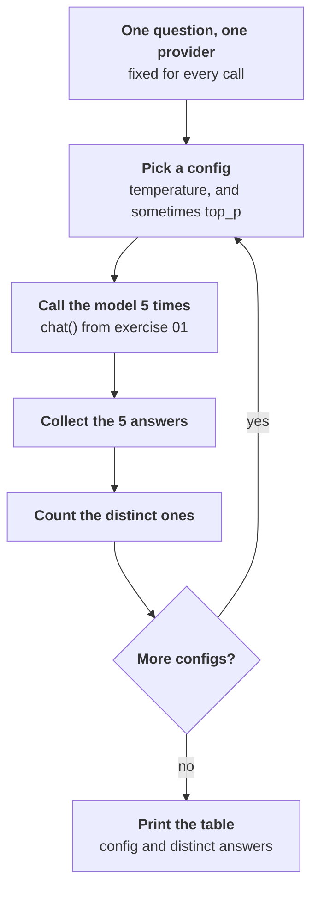

# 02 · Sampling

The same question asked five times under five settings of `temperature` and `top_p`,
counting how many different answers come back.

## Why

A model does not return the answer. It returns one draw from many possible answers,
and `temperature` and `top_p` shape that draw.

- **To see the variation instead of assuming it.** "Lower temperature is more stable" is something everyone repeats. This puts a count next to it.
- **To learn what has to be held fixed.** A comparison is only worth something if one thing changes at a time. Here that meant fixing the question, the provider and one of the two parameters.
- **To know what to expect from temperature 0.** Later entries on evals and tests depend on how repeatable a call is.

## The code, block by block

All of it lives in [`compary.py`](compary.py).

**`sys.path.append(...)` and the import.** The script reuses `chat` and `LLM_MODEL` from exercise 01. That folder is named `01-raw-api-call`, which is not a valid Python module name, so a normal `import` cannot reach it. The line adds the folder to the search path and `client` is then imported as a plain file.

**`SYSTEM` and `QUESTION`.** The same two prompts for every call. If the question changed between calls, the differences in the answers would say nothing about the parameters.

**`PROVIDER`.** Sent to OpenRouter as the `provider` field: use `Reka` only, with `allow_fallbacks` off. In exercise 01 the provider changed from call to call. Without this, a different answer could come from a different machine and not from the setting under test.

**`RUNS` and `CONFIGS`.** Five calls per config and five configs. The first three change only `temperature` (0, 0.7, 1.5). The last two hold `temperature` at 1 and change only `top_p` (0.1 and 1). One parameter moves at a time, so an effect can be tied to it.

**`sample(runs, **params)`.** Calls `chat()` `runs` times with the same parameters and returns the list of answers. `**params` carries the config into the request payload, together with `provider=PROVIDER`. It prints the provider next to each answer, which is how a run shows that the provider really stayed fixed.

**The `__main__` block.** Runs `sample` once per config and stores the config with `len(set(answers))`, the number of distinct answers. A `set` drops exact duplicates, so two answers count as the same only when they match character by character. Then it prints the table.

## What to look at in the output

One run, 25 calls, all served by `Reka`:

| Config | Distinct answers |
|---|---|
| `temperature: 0` | 3 of 5 |
| `temperature: 0.7` | 5 of 5 |
| `temperature: 1.5` | 5 of 5 |
| `temperature: 1, top_p: 0.1` | 4 of 5 |
| `temperature: 1, top_p: 1` | 4 of 5 |

- **Temperature 0 did not give one answer.** It gave 3 distinct answers of 5 here and 4 of 5 in an earlier run of that config alone. It did repeat one answer exactly three times, which no other config did in this run.
- **The provider did not change.** Every call shows `Reka` and the answers still differ. That rules out a provider switch as the cause, not other causes behind the same provider name.
- **No `top_p` effect detected with n=5.** 0.1 and 1 gave the same count, 4 of 5. The limits below give a reason it may not have been applied.
- **Some wording appeared only at 1.5 in this run.** Phrases such as "punctuation mark" and "word fragment" showed up only there. The count cannot show this, because it is already at 5 of 5 from 0.7 up, and one run cannot tell this apart from chance.

## Limits

- **Five runs per config is too few.** The same config gave 3 of 5 and 4 of 5 on two runs. The table shows a direction, not a measured effect.
- **Exact match is a blunt measure.** One changed comma makes two answers distinct. It says how often the text repeats, not how far the answers are from each other.
- **The model reasons before it answers.** In exercise 01 the reasoning text differed between calls. The answer depends on it, so part of the variation may come from there.
- **Nothing confirms the parameters were applied.** The response has no field that echoes `temperature` or `top_p`.
- **One question, one model, one provider.** A short definition has many good phrasings. A question with a single right answer could behave differently.

### The model may ignore these parameters

Checked after the runs, without running anything again.

- **Model and provider.** The provider was `Reka`, fixed in the code and shown on every call. The model was `deepseek/deepseek-v4.1-flash`, the `LLM_MODEL` in `.env` and the model named in the response bodies of exercise 01. The script does not print the model, so the run itself does not record it.
- **It reasons by default.** Exercise 01 saw reasoning tokens without asking for them, and the [DeepSeek thinking mode guide](https://api-docs.deepseek.com/guides/thinking_mode/) says thinking mode is enabled by default.
- **What DeepSeek's docs say about these parameters.** In thinking mode `temperature` is not supported: setting it gives no error and has no effect. For `deepseek-flash`, `top_p` takes effect only in thinking mode, and values below 0.95 are treated as 0.95. Sources: the thinking mode guide and the [Chat Completions reference](https://api-docs.deepseek.com/api/create-chat-completion/).
- **What that would mean here.** If it applies, the three `temperature` configs were the same request as far as sampling goes, and `top_p` 0.1 against 1 was really 0.95 against 1. The differences in the table would then be ordinary run-to-run variation, not an effect of the settings.
- **What could not be confirmed.**
  - Those docs describe DeepSeek's own API and the id `deepseek-flash`. They do not mention V4.1 or say which version that id serves.
  - The calls went to Reka through OpenRouter, not to DeepSeek's API. OpenRouter's public endpoint listing shows `temperature` and `top_p` among Reka's supported parameters for this model. That says they are accepted, not whether they are applied while the model thinks.
  - No source found says what Reka does with them, so whether they were applied in these runs is unknown.

## Open questions

Measurable questions this exercise raises but cannot answer with a few runs. They are
collected for phase 2 in [`experiments/BACKLOG.md`](../../../experiments/BACKLOG.md).

- Are `temperature` and `top_p` applied to this model while it thinks, on this provider? DeepSeek's docs say no for its own API; it was not checked for Reka.
- With thinking turned off, does temperature change the number of distinct answers? This separates the sampling settings from the reasoning step.
- Why did temperature 0 give 3 and 4 distinct answers of 5 with the provider fixed, and how stable is that count over more runs?
- Does a measure of how far answers are from each other show differences that exact match hides, such as the wording seen only at 1.5?
