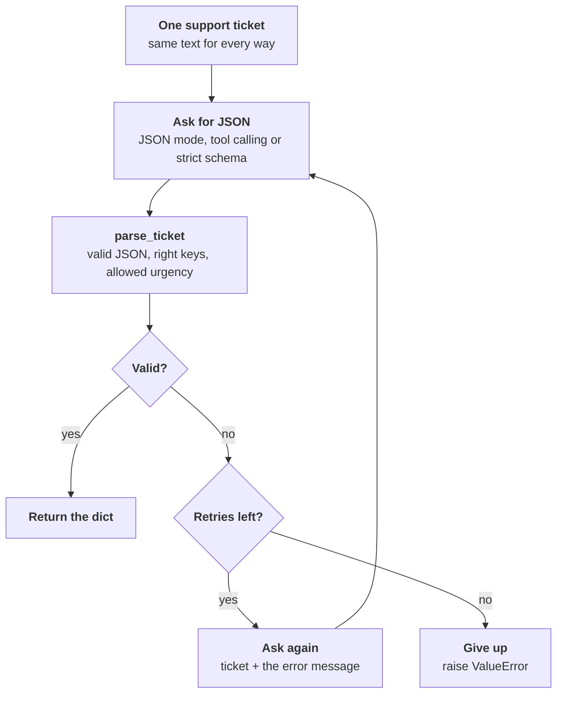

# 03 · Structured output

The same support ticket turned into a fixed JSON object three ways: JSON mode, tool
calling and a strict schema. Code then validates each reply and retries once with the
error when it is wrong.

## Why

When code has to use what the model returns, free text is not enough. It needs an
object with known keys and allowed values.

- **To know what each way guarantees.** JSON mode asks for valid JSON. Tool calling and a strict schema send the shape as a real schema, and a strict schema asks the provider to enforce it.
- **To keep the guarantee in code.** Whatever the request asks for, the reply is a proposal. A validator decides whether it is accepted, and tests pin that decision down.
- **To handle a bad reply on purpose.** Retrying with the exact error, and with a cap, beats both crashing and inventing a default.

## The code, block by block

The code is in [`extract.py`](extract.py) and the tests in [`test_extract.py`](test_extract.py).

**`sys.path.append(...)` and the import.** It reuses `chat` from exercise 01 the same way exercise 02 does. Every request field below goes through its `**params`, so the client did not change.

**`TICKET`.** A short synthetic ticket with a name, a product and an obvious urgency.

**`SYSTEM_JSON`.** For JSON mode the shape exists only in the prompt. The keys and the allowed urgency values are written out in plain words.

**`SCHEMA`.** The same shape as JSON Schema: three required string keys, `urgency` limited by `enum`, and `additionalProperties: False`. Tool calling and the strict schema both send it.

**`KEYS`, `URGENCIES` and `parse_ticket`.** The validator. It takes the raw string and either returns a dict or raises `ValueError` with a message that names the problem:

- `None` is an empty response.
- Text that `json.loads` cannot read is not valid JSON. A reply wrapped in a code fence is rejected here, not cleaned up.
- A list or a number is not an object.
- Missing keys, extra keys and an `urgency` outside the three values each get their own message.

Without it, `json.loads` alone would accept `{"urgency": "urgent"}` and the problem would show up later, far from its cause.

**`extract_json_mode(user)`.** Sends `response_format={"type": "json_object"}` and returns `message.content`. This asks for JSON, but not for this JSON.

**`extract_tool_calling(user)`.** Sends `SCHEMA` as the parameters of a tool called `save_ticket`. `tool_choice` forces the model to call it. The tool is never run: the JSON is in `tool_calls[0].function.arguments`, as a string, so it still needs parsing. The function prints `content`, which was `None` in the runs.

**`extract_strict_schema(user)`.** Sends `response_format` of type `json_schema` with `strict: True`. According to OpenRouter's documentation, a provider that does not support this field can ignore it, and `provider={"require_parameters": True}` limits routing to providers that support every field sent. The function prints the provider to show which one served the call.

**`extract_with_retry(extract, ticket, retries=1)`.** One loop for the three ways, which are passed in as functions. It calls `extract`, then `parse_ticket`. On a `ValueError` it builds a new prompt from the original ticket plus the error message and tries again. After `retries + 1` attempts it raises. The new prompt is built from `ticket` each time, so errors do not pile up.

**The `__main__` block.** Runs the three ways through `extract_with_retry` and prints each dict.

**`test_extract.py`.** Offline tests, with no network and no key:

- It sets fake values for the three `.env` variables before the import, because importing `client` raises when they are empty.
- `parse_ticket` is tested with one valid reply, a pretty-printed one and six bad ones, each matched to its error message.
- `extract_with_retry` is tested with a fake `extract` that returns canned replies. One test checks that a bad reply is fixed on the second attempt and that the error reached the new prompt. The other checks that the loop stops after two attempts.

The second retry test caught a real bug while this was built: the final `raise` was indented inside the loop, so it gave up after the first rejection.

## What to look at in the output

| Field | Meaning |
|---|---|
| `message.content` | Where JSON mode and the strict schema put the JSON |
| `message.tool_calls[0].function.arguments` | Where tool calling puts it, as a string |
| `provider` | Which provider served the strict-schema call |
| `attempt N rejected: ...` | Printed only when `parse_ticket` rejects a reply |

Seen in real runs:

- **All three ways returned a valid object** on this ticket, so no retry was needed. The retry path is covered by the tests, not by a real failure.
- **The raw text differed.** The strict schema came back pretty-printed, with line breaks and indentation. The other two came back on one line. The parsed dicts were the same, which is why replies are compared after parsing.
- **Valid is not the same as correct.** In one run JSON mode and tool calling gave `product: "Pro Plan dashboard"` and the strict schema gave `"Pro Plan"`. Both pass the schema. Checking the value itself is a job for evals.
- **The strict schema moved between providers.** It was served by `Wafer` in some runs and `DeepInfra` in another.
