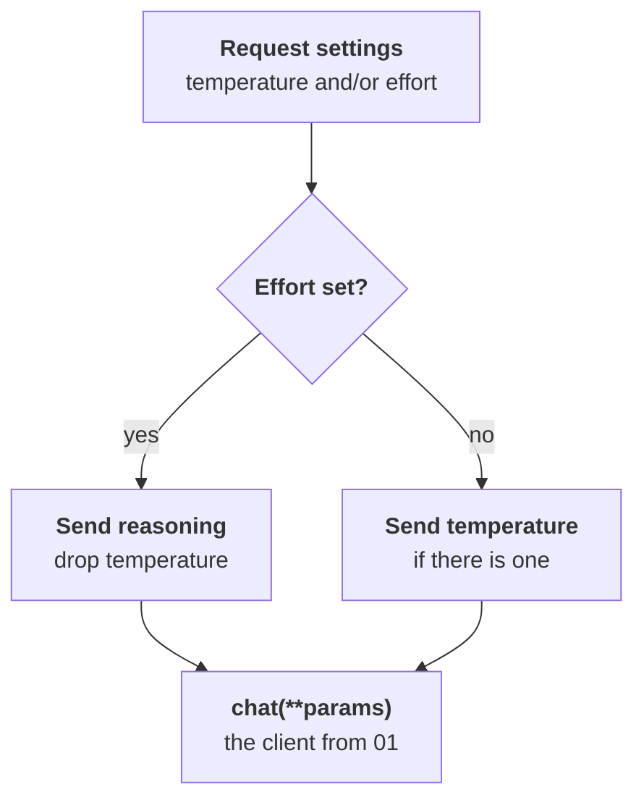

# 04 · Parameter layer

One function decides which sampling parameters a request carries: when reasoning effort
is set, `temperature` is dropped instead of sent.

## Why

- **Some parameters do not mix.** According to several providers' documentation, reasoning models reject or ignore `temperature` while reasoning is on. This was not reproduced here: the call with the parameter dropped simply worked.
- **One place for the rule.** Instead of remembering it at every call site, every request builds its parameters through `build_params`.
- **Nothing is dropped silently.** The function prints when it discards `temperature`, so a caller who asked for it can see why it did not go out.

## The code, block by block

The code is in [`params.py`](params.py).

**`sys.path.append(...)` and the import.** Reuses `chat` from exercise 01, like 02 and 03. The parameters go through its `**params`, so the client did not change.

**`build_params(temperature, effort)`.** Returns the dict of extra request fields. With `effort`, it returns `{"reasoning": {"effort": effort}}`, OpenRouter's format for asking for reasoning, and prints a line if a `temperature` was also given. Without `effort`, it returns `temperature` when there is one. With neither, it returns `{}` and the provider defaults apply.

**The `__main__` block.** Calls the model with three settings: temperature only, both (temperature dropped), and effort only. For each it prints what was sent, `usage.completion_tokens_details.reasoning_tokens`, the completion tokens and the answer.

A typo in that key, `completion_token_details`, printed `None` with no error, because `.get` falls back to `{}`. Reading usage this way hides a wrong key.

## What to look at in the output

| Field | Meaning |
|---|---|
| `sent:` | The fields `build_params` produced, after the rule |
| `dropping temperature=...` | Printed when the rule removed `temperature` |
| `reasoning tokens` | `usage.completion_tokens_details.reasoning_tokens` |
| `completion tokens` | Answer plus reasoning |

Seen in one run of each setting:

- **The request without `temperature` went through** with `reasoning` set, and the answer was normal.
- **The model reasoned with no effort set:** 59 reasoning tokens with temperature only.
- **`high` did not reason more than `low`:** 36 against 54 reasoning tokens. On a one-sentence question and a single run, effort reads as a hint to the model, not a token budget. That is a direction to check, not a measured result.

## Open questions

Measurable questions this exercise raises but cannot answer with a few runs. They are
collected for phase 2 in [`experiments/BACKLOG.md`](../../../experiments/BACKLOG.md).

- Does reasoning effort change the number of reasoning tokens in a consistent direction? In one run `high` used 36 and `low` used 54.
- Does the model reason on every call when no effort is set? One call with temperature only used 59 reasoning tokens.
- Does sending `temperature` together with reasoning get rejected, ignored or applied? The docs claim was not reproduced; the call with it dropped simply worked.
