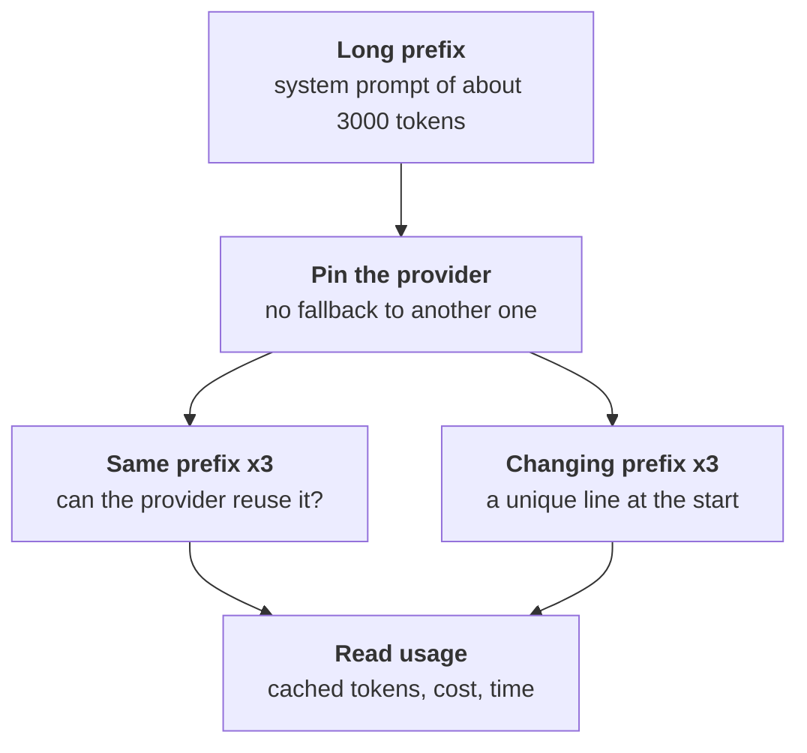

# 05 · Prompt caching

The same long system prompt sent several times, against one that changes on every call,
to see what a cached prefix does to cost and latency.

## Why

- **Most real prompts repeat a long prefix.** System prompts, documents and tool definitions come first and stay the same between calls. According to provider documentation, a provider can reuse the work done on a prefix it has already seen and charge less for those tokens.
- **To see what the cache depends on.** The cache lives at the provider. When OpenRouter routes a call to a different provider, the prefix is new again.
- **To measure it, not assume it.** `usage` reports how many prompt tokens came from the cache and what the call cost, so the effect can be read directly.

## The code, block by block

The code is in [`cache.py`](cache.py).

**`sys.path.append(...)` and the import.** Reuses `chat` from exercise 01, like the earlier exercises. The routing settings go through its `**params`.

**`PREFIX`.** One line of role plus 200 numbered rules, about 3000 tokens. Provider documentation says automatic caching starts at around 1024 tokens of prefix, so a short system prompt would not show any effect.

**`timed_call(system, user, **params)`.** Times the call with `time.perf_counter()` and prints four things: the seconds, `usage.prompt_tokens`, `usage.prompt_tokens_details.cached_tokens` and `usage.cost`, plus the `provider` that served it. The `or {}` fallback keeps it from failing when a provider sends no details, but it also prints `None` for a mistyped key, as happened in exercise 04.

**`pin`.** `provider.order` with a single provider and `allow_fallbacks: False`. According to OpenRouter's documentation, this keeps every call on that provider. Without it, the first runs moved between CoreWeave, Alibaba, Cohere and InferenceNet, and a hit was lost as soon as the provider changed.

**The `__main__` block.** Three calls with `PREFIX` as is, then three with `f"Session {time.time_ns()}-{i}.\n"` placed before it. The line goes at the start because only a shared start can be reused. `time_ns()` keeps it unique across runs of the script too, so one run cannot hit the cache left by an earlier one.

## What to look at in the output

| Field | Meaning |
|---|---|
| `cached` | Prompt tokens served from the cache. `0` is a miss |
| `cost` | What the call cost, from `usage.cost` |
| `provider` | Who served it. The cache does not carry over between providers |
| seconds | Wall time of the whole call, network included |

Seen in real runs:

- **Without pinning, the cache was mostly lost.** In two runs of three calls each there was only one hit, on CoreWeave, right after another call to CoreWeave. When the next call went to Alibaba, the hit was gone.
- **A changing prefix was never cached:** `0` in all six calls across two runs, as expected.
- **A hit cost about 3–5 times less.** On Alibaba, from 0.00066–0.00070 without the cache to 0.00012–0.00015 with it. On CoreWeave, from about 0.00054 to 0.00011–0.00019.
- **A pinned provider is not a guarantee.** On CoreWeave the same prefix hit once and then missed on the third call. On Alibaba all three calls hit, the first one included, because an earlier run had already cached the prefix. Why CoreWeave missed was not checked.
- **The cached count comes in blocks:** 2048, 2816, 2944, never the full 3047. The tail of the prompt, the user message included, is always processed again. This is read from the numbers, not from documentation.
- **Latency did not follow the cache.** Hits took 1.5–2.5s and misses 1.6–2.4s, with one 14.7s outlier on a miss. At about 3000 tokens, any saving is smaller than network noise in these few calls.

## Open questions

Measurable questions this exercise raises but cannot answer with a few runs. They are
collected for phase 2 in [`experiments/BACKLOG.md`](../../../experiments/BACKLOG.md).

- With the provider pinned and the same prefix, how often is the cache missed? CoreWeave missed once in three calls; Alibaba hit three of three.
- Does a cache hit lower latency with a longer prefix? No gain was detected at about 3000 tokens.
- How long does a cached prefix last? On Alibaba the first call of a later run already hit.
- What block size does each provider cache in? `cached` came as 2048, 2816 and 2944 of 3047.
